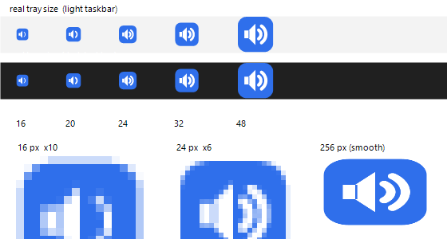

# MonitorAudioSwitcher

**Windows：让每个应用的音频跟着它的窗口走。**

把浏览器、游戏、音乐播放器或 Discord 拖到副屏，**只有这个应用**会切到你给副屏指定的输出设备；
拖回主屏，它回到系统默认设备。**系统全局默认播放设备全程不动**——其它程序该走哪儿还走哪儿。

Windows 本身已经支持"每个应用单独选输出设备"（设置 → 系统 → 声音 → 音量合成器），
但那是静态设置，它不知道应用在哪块屏幕上。这个工具补的就是这一块。

<p align="center">
  
</p>

---

## 和现成方案的区别

| 工具 | 做什么 | 自动 | 按应用 |
| --- | --- | --- | --- |
| **MonitorAudioSwitcher** | 把**每个应用**送到**它窗口所在显示器**对应的设备 | ✅ | ✅ |
| [AutoAudioSwitcher](https://github.com/maxkagamine/AutoAudioSwitcher) | 按**焦点窗口**所在屏切换**全局默认设备** | ✅ | ❌ |
| [EarTrumpet](https://eartrumpet.app) | 手动调每个应用的音量和输出设备 | ❌ | ✅ |
| [App Audio Router](https://github.com/Eververdants/AppAudioRouter) | 把一个应用同时送到**多个**设备（抓流重放） | ❌ | ✅ |

"按应用" + "跟着窗口走"这个组合是空档：可以一边在电视上放视频、一边让游戏继续用耳机，
其它声音一点都不动。

---

## 环境要求

- Windows 10 1803+ 或 Windows 11（64 位）
- Windows PowerShell 5.1（系统自带，不需要装任何东西）
- 不需要管理员权限、不需要驱动、不需要虚拟声卡、没有第三方 exe

整个工具就是两个文件：一个 PowerShell 脚本 + 一小段启动时在内存里编译的 C# 互操作代码。

---

## 快速开始

1. 把仓库下载/克隆到一个固定位置（例如 `C:\Tools\MonitorAudioSwitcher`）。
2. 先看一次状态：

   ```powershell
   powershell -NoProfile -ExecutionPolicy Bypass -File .\MonitorAudioSwitcher.ps1 -Status
   ```

   首次运行会自动生成 `config.json`，每块显示器一条，都先指向 `default`。
   同一份输出里还能看到当前所有"有音频会话"的应用。

3. 把副屏那块屏的**输出设备全名**填进 `config.json`（从 设置 → 系统 → 声音 抄，或直接从 `-Status` 里抄）：

   ```json
   "\\\\.\\DISPLAY2": { "label": "Secondary", "device": "Monitor (NVIDIA High Definition Audio)" }
   ```

4. 跑一次自检——它会真切一次、读回、再还原：

   ```powershell
   powershell -NoProfile -ExecutionPolicy Bypass -File .\MonitorAudioSwitcher.ps1 -SelfTest
   ```

   两个 `HRESULT = 0x00000000` 就说明这台机器支持。

5. 双击 `Start-MonitorAudioSwitcher.vbs` 后台启动（不弹黑框）。托盘出现图标，右键有菜单。
   现在随便拖一个窗口到另一块屏试试。

要开机自启：右键托盘图标 → 勾选 **开机自启动**。

---

## 工作原理

Windows 把"每个应用的输出设备"存在按应用的音频策略库里。本工具调用
`Windows.Media.Internal.AudioPolicyConfig`（音量合成器自己用的同一个未公开 WinRT 类），
按**进程**设置：

1. 取前台窗口，看它属于哪个程序；
2. 这个程序当前必须拥有音频会话（即音量合成器里能看到它）才算"能出声"；
3. 取窗口中心所在的显示器；
4. 从音频会话里找出**真正持有声音的那个进程**——Chromium 系浏览器的音频会话经常不在
   带窗口的那个进程上，用窗口 PID 会静默失败；
5. 把这个应用的持久化输出设备指向该显示器映射的设备。

同一个 exe 的所有进程共享一份按应用设置，所以 Edge 那几十个进程一次调用就全覆盖；
不同应用各存各的。

工具只在**窗口换屏**（或应用重启、重新开始出声）时动作，不会每隔几秒跟你在音量合成器里
的手动修改抢控制权。

### 为什么"回到默认"不直接清除

给接口传 NULL 可以清除按应用的自定义，但在当前 Windows 上这**不会**把正在播放的流搬回来，
非得重启应用才行。所以 `defaultHandling` 默认是 `pin`：映射为 `"default"` 的屏幕上，
把这个应用**明确固定到当前的系统默认设备**。声音立刻搬回来；之后你若改了系统默认设备，
工具会在需要时重新对齐。

---

## 配置

`config.json` 和脚本放在一起，首次运行自动生成，并且已被 git 忽略。
完整示例见 [`config.example.json`](config.example.json)。

| 字段 | 说明 |
| --- | --- |
| `trackMode` | `anyAudioApp`（默认）任何能出声的应用都接管；`list` 只接管 `trackedProcesses` |
| `trackedProcesses` | 白名单，仅 `trackMode: "list"` 时生效；进程名小写、不带 `.exe` |
| `excludeProcesses` | 黑名单，两种模式都生效；默认排除 `wallpaper64`（Wallpaper Engine）和 `nvcontainer` |
| `monitorDevices` | 屏幕 → 设备映射；键是显示器名（`\\.\DISPLAY1` …），不要改 |
| `pollIntervalMs` | 检查前台窗口的间隔，默认 `300` ms |
| `retrySeconds` | 目标应用还没有音频会话、或写入失败时的重试间隔，默认 `5` 秒 |
| `syncOnNewSession` | 应用重启/重新出声时重新对齐，默认开 |
| `defaultHandling` | `pin`（默认）或 `clear`，见上一节 |
| `notifyOnSwitch` | 切换时是否弹通知，默认 `false` |
| `showTrayIcon` | 是否显示托盘图标 |
| `trayIconStyle` | 图标样式：`speaker` / `screens` / `screenwave` |
| `trayIconColor` | 图标底色（十六进制） |
| `applyOnStart` | 启动时先对齐一次 |

`device` 可以写完整设备名、设备名的唯一一段，或 `"default"`。

改完配置不用重启：右键托盘 → **重新载入 config.json**。

---

## 命令行

| 参数 | 作用 |
| --- | --- |
| （无） | 后台常驻（托盘图标） |
| `-Status` | 打印显示器映射、当前音频会话、判定结果 |
| `-SelfTest` | 真机切换 + 读回 + 还原，打印 HRESULT |
| `-DryRun` | 只判断不修改 |
| `-Simulate "\\.\DISPLAY2"` | 假装窗口在 2 号屏并立即执行 |
| `-Simulate "\\.\DISPLAY2" -Process firefox` | 同上，指定应用 |
| `-RunForSeconds 10` | 跑 10 秒后退出（测试用） |
| `-InstallStartup` / `-UninstallStartup` | 安装 / 移除开机启动 |
| `-NoTray` | 不显示托盘图标 |

---

## 排查

日志就在脚本旁边：`MonitorAudioSwitcher.log`。

| HRESULT | 含义 | 处理 |
| --- | --- | --- |
| `0x00000000` | 成功 | — |
| `0x80070005` | 拒绝访问 | 用你自己的桌面 PowerShell 会话运行（受限令牌会被拒） |
| `0x80070057` | 参数无效 | 那一刻该应用还没有音频会话；先放点声音，工具会自动重试 |
| `0x80004005` | 接口异常 | 看日志里的 `LastError` |

常见情况：

- **拖了但没变化**：先让这个应用出点声，再确认 `-Status` 的音频会话里有它。从未出过声的程序，
  Windows 里没有可设置项。
- **某个应用不听话**：Chromium 系浏览器可能在 `chrome://settings` 或网页里单独锁了输出设备，
  改回"默认"；WASAPI 独占的游戏无法路由。
- **不想让某个程序跟着走**：加进 `excludeProcesses` 后重新载入配置。
- **管得太多**：把 `trackMode` 改成 `list`，用白名单。
- **开机自启没出现**：安全软件常拦写入启动文件夹的 `.vbs`，看日志里的 `写入开机启动失败`；
  或者用任务计划程序建一个"登录时"任务，运行
  `powershell.exe -NoProfile -ExecutionPolicy Bypass -WindowStyle Hidden -File "<路径>\MonitorAudioSwitcher.ps1"`。
- **挪了文件夹**：启动项里存的是绝对路径，重新跑一次 `-InstallStartup`。

### 杀软误报

一个会往启动文件夹写 `.vbs` 的 PowerShell 脚本，对部分杀软来说很像可疑行为。
源码都在这儿，可以先审再跑，或者不用自启、手动启动。运行时不下载任何东西。

---

## 已知限制

- 用的是**未公开**接口（`Windows.Media.Internal.AudioPolicyConfig`），自 Windows 10 1803 起稳定，
  但未来系统更新有可能失效。
- 判定基于**前台窗口**；后台应用维持现有设备。
- 按应用设置是**持久化**的：退出工具后，最后一次的分配仍然保留（这是 Windows 特性）。
- 重新插拔线缆后 `\\.\DISPLAY1/2` 编号可能变化，用 `-Status` 复查。
- 只有出现在音量合成器里的应用才能被路由。

---

## 实测情况

Windows 11（build 26200）、两块接不同输出设备的显示器，使用浏览器、游戏、音乐播放器、
聊天客户端测试。按应用切换、播放中实时搬运、切回系统默认、开机启动项均已验证。

尚未验证：多个**不同**应用同时分别固定在不同显示器上的交互表现
（按设计每个应用互不影响，但没有做过多应用并存的实测）。

---

## 致谢

- 内部接口的细节（IID、vtable 顺序、HSTRING 处理）参照了
  [EarTrumpet](https://github.com/File-New-Project/EarTrumpet)，它用的是同一套 Windows API。
- "跟着焦点窗口所在显示器走"这个思路来自
  [AutoAudioSwitcher](https://github.com/maxkagamine/AutoAudioSwitcher)。

## 许可

[MIT](LICENSE)
